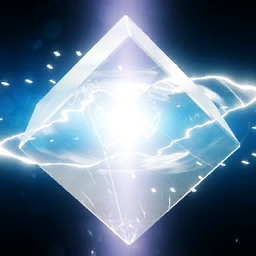

<p align="center"></p>

# Cephalon Ordis — The Rats Den 69 clan bot

**Cephalon Ordis** is the Discord companion bot for the Warframe clan **The Rats Den 69**. It keeps a live World State
board in each alert channel, answers Warframe questions in chat (from live game data and the wiki, with no AI model and
nothing to pay), looks up items and what relics are worth, grades rivens from a screenshot, shows market prices, DMs
members about what they track, runs clan events, LFG squads, giveaways and levels, and serves an **MCP server** so AI
assistants (Claude Code, Claude Desktop, …) can read Warframe data and manage the clan.

## Features

### Ask Ordis

Mention the bot (`@Cephalon Ordis where does Neo N16 drop?`), use `/ask`, DM it (clan members only), or write in the
`/setup chat` channel. No language model is involved: Ordis works out what you're asking with fixed rules and answers
from live data and his local copy of the wiki, so he never makes anything up.

| You ask | Ordis answers with |
| --- | --- |
| "price of Arcane Energize", "how much is Wisp Prime set worth?" | warframe.market sellers and buyers |
| "when can I get the Torid Incarnon?", "what's in the Steel Path Circuit this week?" | the exact week and date, counted from the wiki's rotation table and the live world state |
| "where does Neo N16 drop?", "what's in Axi A1?", "Kuva Bramma stats" | the drop tables, or the item or relic card (a relic with each reward's price and what a run is worth) |
| "when is Baro coming?", "is it night on Cetus?", "today's sortie", "Entrati bounties", "steel path axi fissures" | the live world state |
| "when is our next clan event?" | the clan's upcoming events |
| "how many points for MR 25?", "how do I make Corrosive?", "what is 9 x 2" | the mastery thresholds, the element recipe, the sum |
| anything else, like "how do archon shards work?" | the sentence of the wiki page the question names that fits it best, quoted word for word, and links to the 1–3 most relevant pages |

In the chat channel Ordis answers anything written there without a mention, but stays out of replies between members and
of chatter that names no wiki page. It needs the Message Content intent: enable it in the Developer Portal first, then set
`ENABLE_MESSAGE_CONTENT=true`. `/ailog` shows staff what was asked and how it was answered.

### Commands

| Command | What it does |
| --- | --- |
| `/ask question` | Ask Ordis anything about Warframe |
| `/item name` | Stats for a Warframe (abilities, polarities), weapon (damage, crit, status, riven disposition), mod or arcane (max-rank effect, best drop sources) or relic (contents with intact → radiant chances, each reward's price, what a run is worth, vaulted status) |
| `/relics [refinement] [squad] [vaulted] [tier]` | The relics worth the most plat per run, alone or in a radshare |
| `/price item` | warframe.market cheapest online sellers and top buyers, with a ready-to-paste whisper |
| `/drops item` | Where an item, mod or relic drops, with chances |
| `/wiki query` | Wiki article summary and link |
| `/wf cycles · fissures · sortie · archon · baro · steelpath · invasions · nightwave · deals · events · archimedea · bounties · resurgence` | Live world state, including Darvo's deal, events, Deep/Temporal Archimedea, syndicate bounties and Varzia's Prime Resurgence |
| `/riven grade · scan · find · watch · top · status` | Grade a riven from its stats or a screenshot, list the cheapest matching rivens for sale, get a DM when one is listed below your price |
| `/alecaframe link · stats · relics · unlink` | Link your own AlecaFrame stats (opt-in, see below) |
| `/track reward · fissure · cycle · baro · arbitration · sortie · archon · weekly · price · list · remove` | Personal DM alerts: a reward containing a word (invasions, alerts, events, Darvo, Baro, Varzia, Steel Path), fissures matching tier/mission/Steel Path/Void Storm, a cycle starting (e.g. Cetus night), Baro arriving, an Arbitration of a tier or mission type, a sortie or Archon Hunt, the weekly reset, a market price dropping. The same DMs can be set up from each World State board's menu |
| `/clan info · register · unregister · whois · roster` | Link Discord members to in-game names, MR and platform |
| `/event create · list · cancel` | Clan events with ✅ / 🤔 / ❌ RSVP buttons, an optional end, a matching Discord scheduled event and a reminder ping 15 min before start |
| `/lfg activity [details] [size] [expires]` | Squad post with Join / Leave / Close buttons; pings everyone when full. With squad voice on, it also gets its own voice channel |
| `/activity set · clear · list` | (Manage Server) a picture, ping role and fixed channel for each LFG activity |
| `/giveaway start · end · reroll · list` | A giveaway with an Enter button and 1–10 winners, drawn when it ends |
| `/birthday set · remove · list` | Ordis wishes you a happy birthday on the day (only day and month are stored) |
| `/rank` · `/leaderboard` · `/xp` | Levels from chat and voice, with Level roles; staff can give XP, set levels and ignore channels |
| `/roles add · remove · post · list` | (Manage Roles) a self-assign panel with one button per role |
| `/sticky set · edit · remove · list` | (Manage Messages) a message Ordis keeps at the bottom of a channel |
| `/vc rename · limit · lock · unlock` | Change your own join-to-create voice room |
| `/inactive [days]` | (Kick Members) members who haven't written or talked in a while |
| `/ailog [count] [member]` | (Manage Messages) the latest questions Ordis answered |
| `/setup …` | (Manage Server) choose channels: `feed board: channel: [ping_role]` puts one World State board in a channel; also chat, announcements, welcome, modlog, auditlog, status, honeypot, ssroles, rivens, levels, weekly, news, promos, birthdays, pings, autovc and lfgvoice, plus `off` and `show` |

### Moderation

| Command | Who can use it | What it does |
| --- | --- | --- |
| `/purge amount [user] [bots_only] [include_pinned]` | Manage Messages | Deletes the last 1–1000 messages, or `all`, in the current channel. Pinned messages are kept unless asked. More than 100, or `all`, asks for confirmation first. Messages older than 14 days can't be bulk-deleted by Discord, so they're removed one by one (up to 300 per run) |
| `/warn user reason` · `/warnings user [clear]` | Timeout Members | Recorded warnings, DMed to the member |
| `/timeout user duration [reason]` · `/untimeout user` | Timeout Members | Discord timeout, e.g. `10m`, `1h`, `1d` (max 28 days) |
| `/kick user [reason]` | Kick Members | Removes the member (DMed first) |
| `/ban user [reason] [delete_messages]` · `/unban user` | Ban Members | Bans by user (even if they've left); unban picks from the ban list |
| `/slowmode interval [channel]` | Manage Channels | `off` or e.g. `10s`, `2m` (max 6h) |
| `/lock [channel] [reason]` · `/unlock [channel]` | Manage Channels | Members can't post; roles with Manage Messages still can. Unlock restores the exact previous permissions |

Commands are hidden from members without the permission. Nobody can act on themselves, the owner, Ordis, or anyone
whose top role is at or above theirs or Ordis's. Every action is posted to the `/setup modlog` channel and recorded
in Discord's audit log with the moderator's name.

### LFG squads: voice channels and pictures

`/setup lfgvoice category [grace_minutes]` gives every `/lfg` squad its own temporary voice channel in that category. Everyone
can see it, but only the host and squad members can connect: pressing **Join** unlocks it, **Leave** locks it again, and the
size of the squad is the channel's user limit. The squad ends (and its post is closed) when the host has not been in the voice
channel for the grace period (default 5 minutes, counted from creation, so a host who never joins doesn't leave an empty
channel behind), when `expires` runs out (like `30m`, `2h`, `1d`), or when someone presses Close or the host leaves. A closed
squad's voice channel is deleted as soon as it is empty, so nobody is kicked mid-conversation. Each host can have one open
squad with voice at a time. The upkeep runs once a minute and survives restarts. `/setup off feature:Squad voice channels`
turns it off.

`/activity set name [image] [role] [channel]` gives an activity (any name, the suggestions in `/lfg` are only hints) a
**picture** shown on its squad posts, a **role** pinged when the squad is posted, and a **fixed channel** to post in. Use a
direct `https` link to an image. `/activity clear` removes a setting, and `/activity list` shows everything. The same
settings are in the admin panel (Settings page) and the `set_activity`, `list_activities` and `remove_activity` MCP tools.

### The wiki index

Ordis keeps a local, searchable copy of the whole Warframe wiki (about 11,000 articles) in `wiki.db` in the data volume.
Questions that aren't about prices, drops, items or live game data ("how do Archon Shards work?", "what does Iron Skin do?")
are answered from it, and it also feeds `/wiki`, the Circuit rotation, the promo codes post and the `search_wiki` MCP tool.
The first build starts about 90 seconds after startup and takes about a quarter of an hour (one request every 2.5 seconds,
so it is gentle on the wiki). Until then, the live wiki is used. After that Ordis checks every hour and refreshes once the
last refresh is 6 hours old, downloading only pages whose revision changed. The index is rebuildable, is not part of
backups, and takes about 50 MB. Set `WIKI_INDEX=false` to turn it off. Wiki text is available under CC BY-SA.

### Rivens

Post a riven screenshot in the `/setup rivens` channel, or use `/riven scan`, and Ordis answers with a picture: the card,
and next to it a grade for every roll (where the value sits in its 90–110% range, from the wiki's riven tables), the
weapon's most wanted stats among its expensive listings on warframe.market, and what rivens with the same bonuses are
listed for. Two or three screenshots of one weapon's rivens in one message are compared, to say which one to keep.
`/riven find` lists the cheapest matching rivens for sale and `/riven watch` DMs you when one is listed below your price.
Screenshots are read with OCR only and never stored; the market's riven listings are read slowly in the background (one
weapon every 45 seconds).

### Relic values

`/relics`, the relic card and the `relic_values` MCP tool value a relic by what is in it: each reward's price from WFInfo's
price table (served by warframestat.us, read every 6 hours) times its chance at each refinement. Alone that is the plat you
can expect from one reward; in a radshare it is the best of four. Forma counts as nothing, and a reward without a price
too (the answer says so). What relics themselves sell for isn't used: warframe.market has too few live orders per
refinement for that to be reliable.

### AlecaFrame (opt-in)

A member can link their own [AlecaFrame](https://alecaframe.com) stats: in AlecaFrame open **Stats**, press **Create
Public Link**, tick what to share (tick **Relics** for the relic planner), press **Generate token**, then run
`/alecaframe link token:` with the token or the whole link. Ordis keeps only that read-only token, which can be revoked
in AlecaFrame at any time, and reads AlecaFrame at most once a second.

- `/alecaframe stats [period] [share]` draws platinum, ducats, endo, credits, aya and Vitus Essence over time, with relics
  opened and trading totals (never trade partners' names). Only you see it unless you choose `share`.
- `/alecaframe relics` lists your most valuable relics to open and the ones worth refining to Radiant, using the relic
  values above.
- `/alecaframe unlink` forgets the token.

AlecaFrame's overlays and anything its public link doesn't share (riven data, the rest of the inventory) are out of
reach for a bot.

### Join-to-create voice rooms

`/setup autovc lobby` marks a voice channel as the lobby. Whoever joins it gets their own room (`🎧 Name's room`) created
next to the lobby, in the same category, and is moved into it automatically. The room is deleted as soon as it is empty.
Each member has one room at a time (joining the lobby again takes them back to it). The owner can change it with
`/vc rename`, `/vc limit` and `/vc lock` / `/vc unlock` while sitting in it. Upkeep also runs once a minute, so a restart
can't leave empty rooms behind. `/setup off feature:Join-to-create voice` turns it off.

### Honeypot

`/setup honeypot channel [action]` turns a channel into a trap for spam bots and hacked accounts. It posts a "do not post
here" notice, and anyone who then writes in the channel has their message deleted, gets a DM explaining why, and is
removed. `action` is `softban` (default: ban that clears the last hour of their messages in every channel, then unban, so
a real member can rejoin), `ban`, or `kick`. Staff (Administrator, Manage Server, Manage Messages, Moderate, Kick or Ban
Members), the owner and anyone at or above Ordis's role are never trapped. Every catch goes to the mod log. Make the
channel visible to everyone, or bots that can't see it won't fall in. It works without the
Message Content intent. `/setup off feature:Honeypot` turns it off.

### Server backups (Xenon-style)

Ordis snapshots the server: roles (permissions, colors, order), categories and channels (permissions, topics,
slowmode, voice settings), emojis, bans, server settings and its own channel setup. Message history is included too
when `ENABLE_MESSAGE_CONTENT=true`, with the last 50 messages per channel.

| Command (Administrator) | What it does |
| --- | --- |
| `/backup create [label]` | Take a backup now |
| `/backup list` · `/backup info id` | Stored backups and what's in them |
| `/backup download id` | Get the backup as a `.json` file to keep somewhere safe |
| `/backup import file` | Load a downloaded file back into Ordis, even on a brand-new server |
| `/backup load id [mode] [bans] [messages]` | Restore. Shows a preview of every change and waits for confirmation |
| `/backup delete id` | Remove a stored backup |

- **Automatic:** a backup is taken every day, and the newest 14 are kept. Manual backups stay until you delete them.
- **Restore modes:**
  - **Missing only** (the default) recreates what was deleted and touches nothing that still exists, so it's safe to run on a damaged server.
  - **Full sync** also resets existing roles, channels and server settings to how they were in the backup.
- **Safety:** a restore never deletes anything, and it takes a fresh backup first so it can be undone.
- **Recovery:** recreated channels get their old position, category and permissions. Saved messages are re-posted into recreated channels through a webhook under the original author names. Ordis's own alert, event and mod-log channels are re-pointed automatically.
- **If the whole server is deleted:** create a new server, invite Ordis, set `DISCORD_GUILD_ID` to the new server and redeploy. Then run `/backup import` with a downloaded file (or use a stored backup) and `/backup load`. Bot roles from other bots come back when you re-invite those bots.
- **Where backups live:** in Ordis's database volume on your server. Download one now and then so a copy also survives your host going down.

### World State boards

Each World State channel holds one live board that Ordis keeps up to date (`/setup feed`, or the admin panel's Settings
page). Only the messages that changed are edited, so the channels stay quiet:

| Board | What it shows | Pings |
| --- | --- | --- |
| Alerts | Alerts with reward, node and levels; events with progress and interim rewards; Nightwave | The alerts role, for a reward worth a detour (Forma, Catalysts, Reactors, Wraith/Vandal parts, Nitain, 100,000+ Kuva, …) |
| Arbitrations | The one running now, the next 48 hours and the best of the week, each with its S–F tier; "Plan ahead" lists S/A tier hours two weeks ahead | The Arbitrations role, 10 minutes before an S or A tier hour |
| Fissures | Normal, Steel Path and Void Storms, by relic tier | — |
| Sortie and Archon | The sortie, the Archon Hunt and its shard, Deep/Temporal Archimedea, Steel Path honors | — |
| Cycles | Every open world with its next changes (Eidolon nights, warm Orb Vallis), Duviri, the Circuit, bounties | — |
| Traders | Baro Ki'Teer's whole inventory with ducats and credits and, within minutes of his arrival, what each item sells for on warframe.market (plat per ducat, the best resale); Darvo's deal, Varzia's Prime Resurgence, Teshin | The Baro role, when he arrives |
| Invasions | Every invasion with both rewards and its progress | The alerts role, for a notable reward |

Every board has a **🔔 DM me when…** menu and a **My notifications** button, so members can set up their own DMs without
typing a command. The Arbitration schedule and tiers come from [browse.wf](https://browse.wf) (the world state itself from
warframestat.us); Digital Extremes' servers are never called.

A few more channels can be set up the same way: the weekly reset post (`/setup weekly`, also DM'd to the Weeklies role),
game news from the in-game news panel and Warframe's Steam announcements (`/setup news`), the active promo codes from the
wiki (`/setup promos`) and birthday wishes (`/setup birthdays`).

Feature ideas borrowed from community tools: Genesis/WFCD (world-state commands, trackers), Warframe Hub (personal
notifications), warframestat.us (item and drop data) and the wiki.

## 1. Create the Discord application

1. Go to <https://discord.com/developers/applications> → **New Application**.
2. **Bot** tab → **Reset Token** → copy it into `DISCORD_TOKEN`.
   Only if you want welcome messages: enable **Server Members Intent** there and set `ENABLE_WELCOME=true`.
3. Invite it to the clan server (replace `APP_ID` with the Application ID from **General Information**):
   `https://discord.com/oauth2/authorize?client_id=APP_ID&scope=bot+applications.commands&permissions=84992`
   (View Channels, Send Messages, Embed Links, Read Message History). To ping a role that isn't
   "mentionable", also give the bot **Mention @everyone, @here, and All Roles**.
4. Copy the server ID (Discord settings → Advanced → Developer Mode, then right-click the server) into `DISCORD_GUILD_ID`.

Slash commands are registered to that server automatically on startup. Then run `/setup feed` for each World State board and `/setup announcements`.

**Name and avatar:** on startup the bot renames itself to `BOT_NAME` (default `Cephalon Ordis`) and uploads
`assets/clan-logo.png` as its avatar. It only sends a change when something differs, because Discord allows just
a couple of changes per hour. To change the logo, replace that file and ship a new image. The application name in
the Developer Portal (General Information → Name) is separate: set it to `Cephalon Ordis` there too.

## 2. Configure

Copy `.env.example` to `.env` and fill it in. Required: `DISCORD_TOKEN`, `DISCORD_GUILD_ID`.
Set `MCP_AUTH_TOKEN` (24+ characters) to enable the MCP endpoint:

```bash
node -e "console.log(require('crypto').randomBytes(32).toString('base64url'))"
```

## 3. Run

### Docker stack (recommended)

`docker-compose.yml` is the full production stack:

| Service | Image | Role |
| --- | --- | --- |
| `bot` | `$DOCKERHUB_IMAGE:$BOT_TAG` | The bot and MCP server. SQLite database in the `bot-data` volume |
| `caddy` | `caddy:2-alpine` | Public HTTPS for `https://$BOT_DOMAIN/mcp` with automatic Let's Encrypt certificates |
| `watchtower` | `nickfedor/watchtower:1` | Checks Docker Hub every `WATCHTOWER_POLL_INTERVAL` seconds and restarts the bot on a new image |

The bot image is built by GitHub Actions for `linux/amd64` and `linux/arm64`, so a Raspberry Pi works.

1. Point a DNS record (`BOT_DOMAIN`) at the server and open ports **80** and **443**.
2. Next to `docker-compose.yml`, copy `.env.example` to `.env` and fill it in. Required: `DISCORD_TOKEN`,
   `DISCORD_GUILD_ID`, `DOCKERHUB_IMAGE` and `BOT_DOMAIN`. Also set `MCP_AUTH_TOKEN` and
   `MCP_ALLOWED_HOSTS=<BOT_DOMAIN>,localhost,127.0.0.1`.
3. Start it:

   ```bash
   docker compose up -d
   ```

**Portainer:** create a stack from this repository (compose path `docker-compose.yml`) or paste the file. Then
enter the same variables under *Environment variables*. Nothing else needs to be on the host.

**Release flow:** merging to `main` publishes `:latest`, and Watchtower rolls it out within a few minutes.
Set `BOT_TAG` to a version such as `1.2.0` to stay on that release. Watchtower only touches the `bot` container,
because it is the only one with the `com.centurylinklabs.watchtower.enable` label. If the Docker Hub
repository is private, mount a `config.json` with registry credentials into Watchtower.

The bot also listens on `127.0.0.1:3000` on the host itself, for health checks and a Claude Code running on the
server. Watchtower needs the Docker socket, which gives root-level access to the host. Remove the service if
you'd rather update with `docker compose pull && docker compose up -d`.

### Locally

Requires Node.js 24+.

```bash
npm ci
npm run dev
```

## Admin panel

`https://<PUBLIC_URL>/admin` is a web panel for clan admins. You log in with Discord, and only whitelisted Discord IDs get in.

| Page | What you can do |
| --- | --- |
| Overview | Health at a glance: the bot, every background job, the world state, each World State board, members, the next event, the latest backup, and where every feature posts |
| Settings | Every channel and ping role (World State boards, chat, mod and audit logs, welcome, weekly, news, …) and the LFG activities |
| Announce | Write and post an announcement, optionally pinging a role |
| Messages | Edit the text of any message Ordis wrote |
| Events | Create clan events (posted with RSVP buttons) and cancel them |
| Members | Roster and warnings: remove members, clear warnings |
| Backups | Take, download and delete server backups (restoring stays in Discord with `/backup load`) |
| Screenshots | Try the screenshot-roles readers (OCR, the local model, the cloud model) on a picture, without giving any roles |
| Rivens | The riven scan channel, the background market read, a screenshot test and the latest scans |
| Config | Change settings (world state, models, queues, the riven reader, …) without a redeploy |
| Admins | Add or remove panel admins by Discord ID |

**Setup:**
1. In the Discord Developer Portal, open OAuth2 → Redirects and add `https://<PUBLIC_URL>/admin/callback`.
2. Copy the OAuth2 Client Secret.
3. Set `DISCORD_CLIENT_SECRET`, `PUBLIC_URL`, and optionally `PANEL_OWNER_IDS` in the stack. `PANEL_OWNER_IDS` defaults to the clan owner's ID; these owners can't be removed from the panel.

**Security:**
- **Login:** Discord OAuth asks only for the `identify` scope, and Discord's access token is used once and never stored.
- **Sessions:** kept in the database behind an HMAC-signed cookie that is HttpOnly, Secure and SameSite=Lax, scoped to `/admin`, and valid for 7 days.
- **Every request** re-checks the whitelist, so removing an admin signs them out immediately.
- **Forms** carry a CSRF token. Destructive buttons need a "sure" tick.
- **Logging:** every change is posted to the mod log.

## Web endpoints

The bot's HTTP port (3000 in the container) serves:

| Path | What |
| --- | --- |
| `/admin` | Admin panel (see above) |
| `/` | The public status page: one line on the bot, a strip with the next cycle change, Baro, the Arbitration and the sortie, then four sections of tiles (open worlds; the Void, with every open fissure and filters; resets; events and trading) that open and close. Countdowns tick every second and the page updates itself every minute without reloading |
| `/status.json` | The same data as JSON |
| `/logo.png` | The clan logo |
| `/health` | `{"status":"ok","discord":true}` once connected to Discord (used by the Docker health check) |
| `/mcp` | MCP endpoint (below), only when `MCP_AUTH_TOKEN` is set |

The status page shows no member names or Discord IDs. Anyone who can reach the URL can see it, so keep it behind
Cloudflare Access if your event titles are private.

## MCP server

`POST /mcp` speaks MCP over Streamable HTTP and requires `Authorization: Bearer <MCP_AUTH_TOKEN>`.

| Tool | Kind |
| --- | --- |
| `get_worldstate`, `get_fissures`, `lookup_item`, `price_check`, `relic_values`, `search_drops`, `search_wiki`, `search_web` | Warframe data (read-only; `search_web` needs a SearXNG) |
| `grade_riven`, `find_rivens`, `riven_top_rolls`, `riven_status`, `riven_table_check` | Rivens (read-only) |
| `get_clan_overview`, `list_clan_members`, `list_channels_and_roles`, `get_server_structure`, `read_messages`, `list_events`, `list_self_roles`, `list_activities`, `list_inactive_members`, `list_member_levels`, `list_backups` | Clan & Discord info (read-only) |
| `get_bot_health`, `get_ai_log`, `test_answer` | Ordis's health and answers (read-only) |
| `create_event`, `cancel_event`, `send_announcement`, `post_message`, `edit_message`, `delete_message`, `clear_messages`, `post_roles_panel`, `send_weekly_now`, `test_welcome` | Post to Discord |
| `register_member`, `remove_member`, `set_member_level`, `set_self_role`, `set_activity`, `remove_activity`, `update_bot_settings` | Clan roster and settings |
| `create_category`, `create_channel`, `edit_channel`, `set_channel_permissions`, `archive_channel`, `create_role`, `edit_role`, `delete_role`, `edit_server`, `create_backup` | Server admin (channels are archived, never deleted) |
| `update_bot`, `restart_bot` | Pull a new image now, or restart |

**Claude Code** — this repo ships a project `.mcp.json`. Export the token before starting Claude Code. With the
Docker stack, also export the public URL `https://<BOT_DOMAIN>/mcp`, since the default is
`http://localhost:3000/mcp`. Then approve the `cephalon-ordis` server when prompted:

```bash
export RATS_DEN_MCP_TOKEN=<your MCP_AUTH_TOKEN>
```

```bash
export RATS_DEN_MCP_URL=https://bot.example.com/mcp
```

Or add it to any project/user scope by hand:

```bash
claude mcp add --transport http cephalon-ordis https://bot.example.com/mcp --header "Authorization: Bearer <token>"
```

## CI/CD

`.github/workflows/docker-publish.yml` runs typecheck + tests, then builds the multi-arch image:

- push to `main` → `:latest` and `:sha-<short>`
- tag `v1.2.3` → `:1.2.3`, `:1.2` and `:sha-<short>`
- pull requests → build only, nothing pushed

It uses the repository secrets `DOCKER_USERNAME` and `DOCKER_PASSWORD` (preferably a Docker Hub access token with
read/write scope rather than the account password). The image name defaults to `<DOCKER_USERNAME>/rats-den-warframe-bot`; set a repository
**variable** `DOCKERHUB_IMAGE` to override it.

## Data sources

- World state: the community [warframestat.us](https://docs.warframestat.us) API (`api.warframestat.us/<platform>`). The bot does not
  call Digital Extremes' own `api.warframe.com`, which their terms don't allow and which can get an IP blocked from logging in to the game
- Arbitration schedule and tiers: [browse.wf](https://browse.wf) (calamity-inc, MIT)
- Prices and riven listings: [warframe.market](https://warframe.market) API v2
- Relic values: WFInfo's price and relic tables, served by [warframestat.us](https://docs.warframestat.us)
- Drop tables and item data: [warframestat.us](https://docs.warframestat.us)
- Wiki: [wiki.warframe.com](https://wiki.warframe.com) (MediaWiki API, kept as a local index)
- Game news: the world state's news and Warframe's official Steam announcements
- AlecaFrame stats: [stats.alecaframe.com](https://alecaframe.com), only for members who link their own public token

Not affiliated with Digital Extremes.
